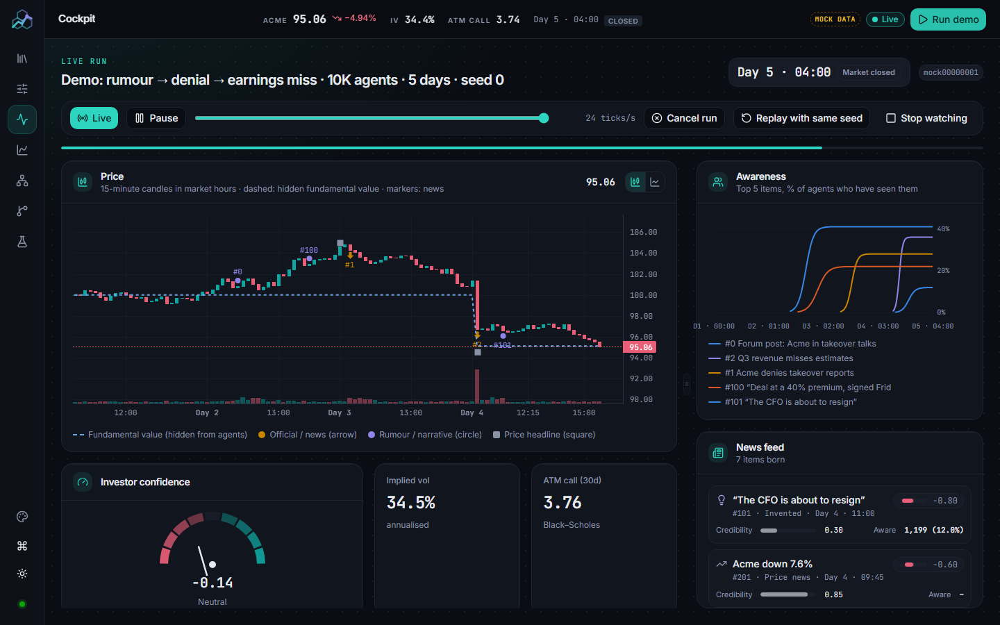
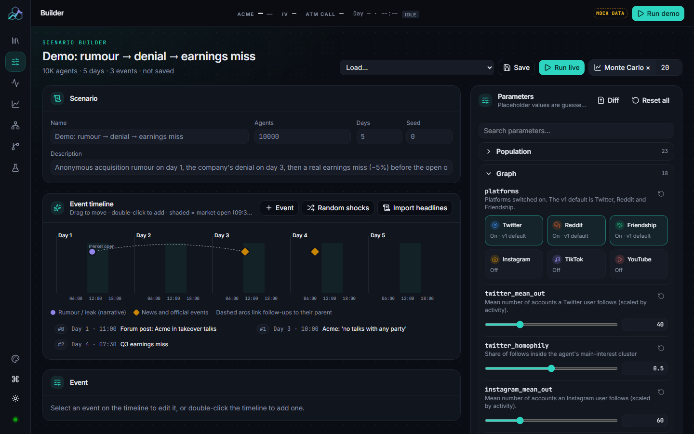
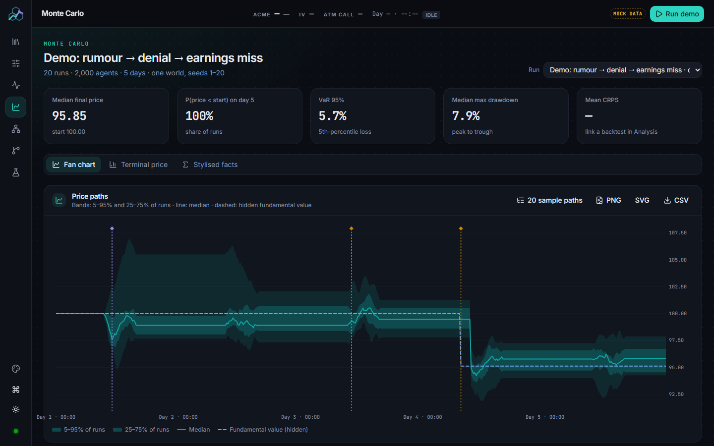
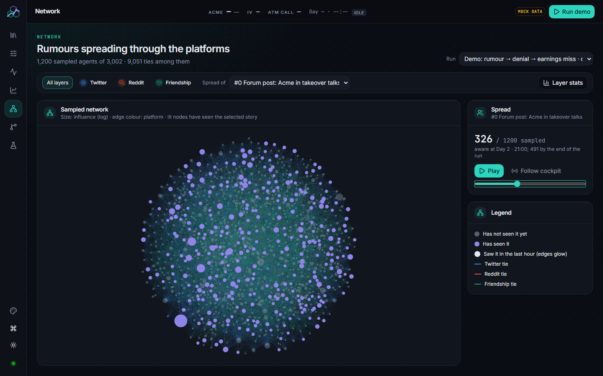
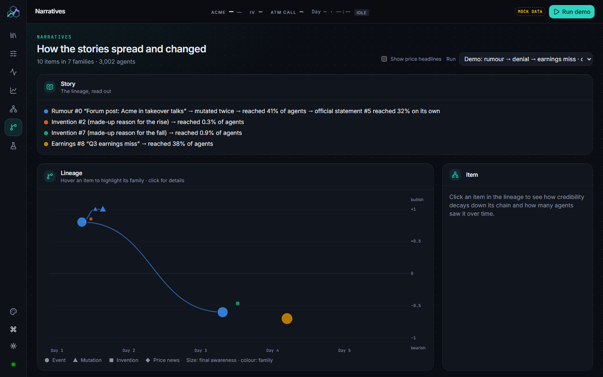

# HiveMind: marketsim

An agent-based simulator for a single stock. Agents with correlated traits live on several social platforms. News and rumours spread between them, change what they believe, and they trade on those beliefs in a batch auction. Running it many times gives a distribution of price paths, which is then calibrated against history and backtested against a random walk.



**Run it:** `docker compose up --build` (or `make up`), then open <http://localhost:8080>. Press **Run demo**: an anonymous takeover rumour spreads through Twitter, Reddit and friendships, the company denies it two days later, and a real earnings miss lands on day 4; watch the price, beliefs and news move tick by tick.

The product has three parts, all complete (issues #1–#25 in [`issues.md`](issues.md)):

1. **Engine** (`marketsim/`, spec in [`HANDOFF.md`](HANDOFF.md)): a vectorised NumPy simulator with a Monte Carlo runner, calibration with a parameter-recovery test, and a CRPS backtest against a random walk.
2. **API** (`api/`): FastAPI. Scenarios and runs, a process-pool job runner, live WebSocket streaming, and every result, calibration and backtest as JSON.
3. **Web app** (`web/`): a night-mode trading-terminal dashboard. Build a scenario, watch it live, then study Monte Carlo fans, the network, narrative lineages, calibrations and backtests.

| | |
|---|---|
|  |  |
| **Builder:** parameters with placeholder badges, an event timeline, headline import, presets | **Monte Carlo:** quantile fan, terminal distribution vs a random walk, stylised facts |
|  |  |
| **Network:** a rumour lighting up a sampled social graph (WebGL) | **Narratives:** lineage tree, family awareness, who heard it |

## Repository layout

```
marketsim/        engine package (pure Python + NumPy, no web code)
api/marketsim_api FastAPI service around the engine
web/              React + TypeScript + Vite front end   (e2e/: Playwright)
tests/            engine tests        api/tests/  API tests
benchmarks/       engine benchmark (10k / 100k / 1M agents)
deploy/           Dockerfiles and the Caddyfile           docker-compose.yml, Makefile
docs/             design notes (source of truth, not edited), screenshots
```

## Full stack in Docker

```bash
docker compose up --build        # or: make up
# open http://localhost:8080
```

Two containers: `api` (uvicorn + the engine, jobs in a process pool, results in the `runs-data` volume) and `web` (the static build served by Caddy, which proxies `/api`, the live WebSocket included). The CI `docker` job builds both, starts them, and checks the app and a real run through Caddy on :8080. `make dev` runs the API on :8000 and the Vite dev server against it instead; `make test`, `make e2e`, `make demo` and `make fixtures` wrap the other common commands.

## Development setup

Requirements: [uv](https://docs.astral.sh/uv/) and Node.js ≥ 20 with corepack (it ships with Node).

```bash
# Python: engine + API + dev tools (uv installs Python 3.12 if needed)
uv sync --all-extras
uv run pytest -q
uv run ruff check . && uv run ruff format --check . && uv run mypy

# API: http://127.0.0.1:8000/docs (interactive OpenAPI docs)
uv run uvicorn marketsim_api.main:app --reload

# Web
corepack enable            # once; or prefix commands with `corepack`
pnpm -C web install
pnpm -C web dev            # http://localhost:5173 (mock API by default, see below)
pnpm -C web test           # unit tests (Vitest + MSW)
pnpm -C web exec playwright install chromium   # once
pnpm -C web e2e            # accessibility (axe, both themes) + end-to-end
pnpm -C web build

# Git hooks (ruff, mypy, prettier, eslint on commit)
uv run pre-commit install
```

## Engine

`marketsim/` is a pure Python + NumPy library (no web code, no network calls). Each tick is 15 minutes; the market is open from 09:30 to 16:00.

| Module | What it does |
|---|---|
| `population` | N agents with eight correlated traits (Gaussian copula), investor categories, platform use, activity hours, communities, interests, influence; media outlets |
| `graph` | Twitter and Instagram (directed Chung–Lu), Friendship (communities + triadic closure), Reddit (subreddit memberships), TikTok (algorithmic), YouTube (creators + upload lag); `layer_stats()` |
| `events` | The event record, a queue, a strict JSON loader, Hawkes shocks, seeding (official / outlet / influencer / insider / anonymous), broadcast |
| `items`, `diffusion` | Circulating news items and who has seen / shared them; spread over every platform with an attention cap |
| `beliefs` | Bounded-confidence belief updates; adopt, mutate and invent narratives |
| `trading`, `firms`, `market` | Retail strategies (fundamental / chartist / sentiment), prop firms and funds, a batch auction against a square-root-impact market maker, Black–Scholes ATM call |
| `sim` | The tick loop, metrics, `on_tick` frames for live streaming, save / load |
| `montecarlo`, `viz`, `run_demo` | R runs on one world, quantile fans, static plots |
| `calibration`, `backtest`, `event_parser` | Random-search calibration + recovery test, CRPS backtest vs a random walk, offline LLM headline parser |

```bash
uv run python -m marketsim.run_demo --agents 10000 --days 5 --runs 20   # plots + summary.json in outputs/ (≈10 s)
uv run python -m marketsim.calibration          # parameter-recovery test (≈1 min)
uv run python -m marketsim.backtest             # backtest on a synthetic series
uv run python benchmarks/bench.py               # build time, s / tick, peak RSS
```

```python
from marketsim.config import Config
from marketsim import scenarios, montecarlo
from marketsim.sim import Simulation

res = Simulation(Config(n_agents=10_000), scenarios.demo(), seed=1).run(5 * 96)
res["series"]["price"], res["summary"]["families"]  # one run
mc = montecarlo.run(Config(), scenarios.demo(), R=20, workers=2)
mc.quantiles()["0.5"], mc.summary()["final_price_quantiles"]  # the distribution
```

Every run is determined by `(config, scenario, seed)`: `config.seed` builds the population and graph, `seed` drives the dynamics.

### Results so far

**Demo** (`run_demo`, 10k agents, 5 days, 20 runs, 7 s): the anonymous takeover rumour reaches ~30% of agents within a day, and ~45% of agents know the story once its official denial (same family) has spread; the −5% earnings miss gaps the price at the next open (median final price 95.4, V_true 95.1). Excess kurtosis of open-tick returns ≈ 59 (dominated by the earnings gap), |r| autocorrelation at lag 1 ≈ 0.03.

**Parameter recovery** (#12, full tables in [`DECISIONS.md`](DECISIONS.md#parameter-recovery-test-12)). From one simulated 5-day path, the four calibrated parameters are only weakly identified:

| parameter | true | recovered (one path) | recovered (median of 8 paths) |
|---|---|---|---|
| `impact_Y` | 0.9 | 1.33 | 0.70 |
| `base_share` | 0.3 | 0.125 | 0.35 |
| `mu0` | 0.4 | 0.39 | 0.15 |
| `sentiment_scale` | 0.055 | 0.084 | 0.033 |

`impact_Y` carries the most signal; `mu0` and `sentiment_scale` barely change the median price path. Calibrated values should not be trusted until the fit uses many events, adds awareness or volume targets, and pins the weak parameters from outside data.

**Benchmarks** (#15, `benchmarks/bench.py`, demo scenario for one day, Windows 11, 32 threads, one process):

| agents | degrees | edges | build | s / tick (mean) | s / tick (market open) | peak RSS |
|---:|---|---:|---:|---:|---:|---:|
| 10,000 | default | 160,442 | 0.2 s | 0.0005 | 0.0012 | 75 MB |
| 100,000 | default | 1,756,497 | 2.2 s | 0.0030 | 0.0044 | 209 MB |
| 1,000,000 | halved | 9,242,273 | 22 s | 0.055 | 0.060 | 1.0 GB |
| 1,000,000 | default | 17,664,579 | 32 s | 0.24 | 0.096 | 1.9 GB |

Per-tick cost follows the number of sharers' edges, not N × items: at 1M the default-degree run is slower because a viral rumour mutates almost every tick (see limitations).

### Known limitations

- **Nothing is fitted to data.** Every `PLACEHOLDER` in `config.py` is a guess; graph statistics are not yet matched to SNAP / Pew / Arctic Shift (see [`DATA_SOURCES.md`](DATA_SOURCES.md)).
- **Weak identifiability** of the calibrated parameters (above).
- **Returns are autocorrelated within the day** (lag-1 ACF ≈ 0.2): agents come online gradually, so order flow is persistent. Volatility clustering is weak.
- **Mutation scales with N.** The handoff's rule gives every sharer a chance to mutate, with at most one child per parent per tick. At 1M agents a viral rumour spawns a child almost every tick (247 in a day), and the 128-slot item store evicts the faintest items.
- **The market maker has unlimited capacity** and re-quotes on public news; its ADV tracks traded volume. There is no inventory-driven quote shading.
- **Retail cannot short**; firms can. One ticker only.
- **The backtest has no skill yet** on synthetic data (skill −0.14 against a random walk): without news inside the horizon, the model adds narrative noise.

### v2

Dealer gamma hedging; several tickers; LLM-driven discretionary funds (the `DiscretionaryPolicy` hook exists); fitting graph layers to data; the `[TBD]` trait from the design notes; per-item (not per-sharer) mutation rates; inventory-aware market making.

### Backtesting on real data

Prices are a CSV with a header and one row per trading day, oldest first:

```csv
date,close
2024-01-02,185.64
2024-01-03,184.25
```

Events are a JSON list (or `{"events": [...]}`) in the same format as scenario events, except that `tick` is replaced by `date` (a date in the CSV) or `day` (a row index), plus an optional `time` (`"HH:MM"`, default `"09:00"`). Only events at or before each origin's close are used for that origin's forecast.

```json
[{"date": "2024-02-01", "time": "16:30", "kind": "earnings", "true_impact": -0.04,
  "sentiment": -0.6, "credibility": 0.95, "salience": 0.8, "complexity": 0.4, "seeding": "official"}]
```

```python
from marketsim.backtest import backtest, load_dated_events, load_price_csv

dates, closes = load_price_csv("prices.csv")
events = load_dated_events("events.json", dates)
res = backtest(closes, events, origins=range(30, len(closes) - 1), horizon=1, runs=20, dates=dates)
print(res.skill)  # 1 − mean CRPS(model) / mean CRPS(random walk); > 0 beats the random walk
```

For historical events, `true_impact` should come from `event_parser.abnormal_return_impact` (an event study) for *calibration only*; using it as a forecast input is lookahead leakage.

## Real stock, real events

Train on a real company's history and its own SEC filings, then forecast its later closes out of sample:

```bash
uv run python scripts/fetch_market_data.py AAPL --start 2015-01-01   # one-off download -> data/AAPL/
uv run python -m marketsim.agent_fit AAPL                            # fit agent behaviour, ~10 min
uv run python -m marketsim.experiment AAPL                           # offline, ~1 h on 10 workers
```

The fetch step saves adjusted closes for the stock and SPY, every 8-K / 10-Q / 10-K with its exact acceptance time, and the reported quarterly EPS and revenue. AAPL from 2015 onwards is committed in `data/AAPL/`. The experiment:

1. turns every filing into an event: its group from the 8-K item codes, the close that first reflects it, features known at the time, and its actual market-adjusted reaction (the label);
2. trains an **impact classifier** on the training years: a logistic regression for down / flat / up, plus a regression for the size of the move;
3. tunes the simulation's market noise and news pass-through on the training years;
4. walks forward through the test period (2024 onwards), forecasting every close 1 and 5 trading days ahead with five models:
   - a random walk;
   - a random walk plus predicted earnings jumps;
   - the agent model's raw runs;
   - the agent model recalibrated on the training years;
   - an "oracle" agent model that is handed the true reactions (a leaky upper bound).
5. writes `docs/experiments/AAPL/report.md` (tables and plots, including the forecasts where the models differ most and every earnings release), `results.json`, and `data/AAPL/events.json` (the events in the Analysis page's upload format).

`marketsim.agent_fit` first fits the agents' behaviour (how strongly sentiment drives orders, strategy switching, risk aversion, the firms' capital and aggressiveness, sharing, unmodelled flow) to AAPL's statistical fingerprint in 2016–2023, using the method of simulated moments (see DECISIONS.md). The experiment then uses the fitted agents and finishes by writing `strategy.json`: the forecast distribution for every test day, forecast statistics, the latest forecast from the last close, and trading strategies built on the model (`python -m marketsim.strategy AAPL` reruns just that step).

The **Real data** page shows the experiment (`GET /api/v1/experiments/{ticker}`). The **Strategy** page shows expected prices, forecast statistics and the trading results (`GET /api/v1/experiments/{ticker}/strategy`).

**Results for AAPL**, with the agents fitted to 2016–2023 (726 one-day and 361 five-day forecasts, January 2024 to November 2026). Skill is 1 − CRPS / random-walk CRPS: above zero beats a random walk.

| model | 1-day skill | 1-day 90% coverage | 5-day skill | 5-day 90% coverage |
|---|---|---|---|---|
| Random walk (trailing 20-day volatility) | 0 | 88% | 0 | 85% |
| Random walk + predicted earnings jumps | −0.7% | 89% | −0.5% | 87% |
| Agent model, raw | −15.3% | 71% | −12.2% | 50% |
| Agent model, recalibrated on 2016–2023 | −0.8% | 87% | −1.8% | 80% |
| Agent model told the true reactions (oracle, leaks the future) | −17.9% | 70% | −8.9% | 49% |

**Trading on it** (daily, 5 bp costs, rules fixed in advance; `strategy.json` and the Strategy page):

| strategy | total return | Sharpe (95% CI) | max drawdown |
|---|---|---|---|
| Buy and hold | +90.4% | 0.95 (−0.13 to 2.03) | −33.4% |
| Direction long/short | −62.1% | −1.09 (−2.04 to −0.16) | −66.7% |
| Direction long/flat | −9.4% | −0.11 (−1.20 to 1.00) | −28.1% |
| Volatility target, model sd | +99.2% | 0.92 (−0.14 to 2.02) | −33.8% |
| Volatility target, trailing sd | +96.2% | 0.91 (−0.21 to 2.01) | −34.0% |
| Earnings classifier | −9.4% | −0.48 (−1.49 to 0.68) | −14.4% |

**What this says.**

- No forecaster beats the random walk out of sample, and no strategy beats buy and hold with any statistical confidence.
- The model's expected return has no relation to the next day's return (information coefficient −0.014, t −0.37). Strategies that trade its direction therefore lose to costs and noise. Before the agent fit, the same long/short rule happened to make +4%; after it, −62%. A swing that large between two variants is what noise looks like.
- The model's spread is mildly informative about the *size* of the next move: its correlation with the size of the next day's move is 0.20, against 0.18 for trailing volatility. Volatility targeting is the one use that does not lose, and it adds almost nothing over plain trailing volatility.
- Fitting the agents to AAPL's statistical fingerprint made the simulation look more like AAPL but forecast worse (raw skill −6% → −15% at one day). Matching the statistics of a price series does not make day-to-day forecasts better.
- The classifier predicts the *size* of a filing's reaction (correlation 0.58) but not its direction (50% of 12 moves).

See [the full report](docs/experiments/AAPL/report.md) and DECISIONS.md for the method and its caveats.

## API

FastAPI service in `api/marketsim_api`. Everything except `/api/health` lives under `/api/v1`:

| Endpoint | Purpose |
|---|---|
| `GET /config/defaults` | Default parameters (from `marketsim/config.py`) and an empty scenario |
| `GET /config/schema` | Every parameter with default, range, description and `placeholder` flag, plus enums and the tick clock |
| `POST/GET/PUT/DELETE /scenarios` | Saved scenarios: agent count, days, seed and scheduled events |
| `POST /runs` | Start a run (single or Monte Carlo) from a saved or inline scenario; `pace` slows a single run down for live viewing |
| `GET /runs`, `GET/DELETE /runs/{id}` | Run index (paged, filter by status) and run details |
| `POST /runs/{id}/cancel` | Stop a queued or running run (it ends as `cancelled`, keeping what it computed) |
| `GET /runs/{id}/series`, `/quantiles`, `/paths`, `/awareness`, `/lineage`, `/stylized-facts`, `/graph`, `/node-seen` | Stored results (`?encoding=b64` packs float arrays; `?every=n` downsamples) |
| `POST /data/upload`, `GET/DELETE /data/{id}` | Datasets: a `date,close` CSV plus dated events, validated on upload |
| `POST /calibrations`, `GET /calibrations/{id}` | Random-search calibration on a dataset, as a job (stream sends one `trial` per trial) |
| `POST /backtests`, `GET /backtests/{id}` | CRPS backtest vs a random walk on a dataset, as a job (one `origin` per origin) |
| `GET /experiments`, `GET /experiments/{ticker}`, `GET /experiments/{ticker}/strategy` | Real-data experiments (`python -m marketsim.experiment`) and their forecasts / strategies, read from `docs/experiments/` |
| `POST /events/parse` | Headlines → events. No provider by default: it returns prompts to paste into any LLM, then validates the replies you post back |
| `WS /runs/{id}/stream` | Live frames: `hello`, then `tick` / `event` / `narrative` (or Monte Carlo `progress`), then `done` or `error`; `?after=<tick>` resumes |

The parameter models are generated from the `config.py` dataclasses, so adding a field there adds it to the API (give it a range in `config_schema.FIELD_RANGES`; a test enforces this). Runs are stored under `MARKETSIM_DATA_DIR` (default `./runs`): `index.sqlite3` plus `runs/<id>/spec.json` and the results (`result/` for a single run, `mc/` for Monte Carlo). Jobs run in a process pool of `MARKETSIM_MAX_JOBS` workers (default 2); further runs wait as `queued`. Each run has a `spec_hash`, and equal hashes mean identical results.

**Headline parsing with Claude (optional).** `uv sync --extra llm` and set `MARKETSIM_LLM_PROVIDER=anthropic` plus an Anthropic credential (`ANTHROPIC_API_KEY` or an `ant auth login` profile). The API then calls `claude-opus-5-5` (`MARKETSIM_LLM_MODEL` to change it) at low effort, caches every reply in `<data dir>/llm_cache.json`, and turns on server-side refusal fallbacks. Without the variable the API makes no network calls.

After changing the API, regenerate the spec and the web types (CI checks both):

```bash
uv run python -m marketsim_api.export_openapi
pnpm -C web gen:api
```

## Web app

React 19 + TypeScript + Vite, Tailwind 4 + shadcn/ui (Radix), Motion, TanStack Query, Zustand. The design is a night-mode trading terminal, with dark as the default and a light theme too. `/design` shows every token and component in both themes.

- **Mock API.** `web/.env.development` sets `VITE_API_MOCK=true`, so `pnpm dev` runs against an in-browser mock of the FastAPI routes plus a replayed live stream (MSW, `web/src/mocks`). A "MOCK DATA" tag in the top bar says so. Set `VITE_API_MOCK=false` and run the API on :8000 to use the real backend; Vite proxies `/api`. Production builds never include the mocks.
- **Live data.** `WS /api/v1/runs/{id}/stream` messages are defined in `web/src/lib/live/types.ts`, and the API sends exactly those shapes. Frames go into ring buffers outside React state, and subscribers re-render at most once per animation frame.
- **Shortcuts.** `Ctrl/⌘ K` opens the command palette. Charts can be read with the keyboard: focus a chart, then use ← →.
- **Accessibility.** The e2e suite runs axe (WCAG 2.1 AA, including colour contrast) on every page in both themes and on the live / interactive states. Animations respect `prefers-reduced-motion`.

| Page | What it does |
|---|---|
| **Runs** | Every run with status, spec hash, sparkline and final move; open, duplicate into the Builder, delete; tick two to compare them (paths on one axis + the settings that differ) |
| **Builder** | Parameters generated from `/config/schema` (ranges, placeholder badges, reset, diff), platform cards, a drag-and-drop event timeline, Hawkes random shocks, headline import through an LLM, presets, save / load, **Run live** and **Monte Carlo ×R** |
| **Cockpit** | Candles in market hours with event markers and the hidden fundamental value, confidence gauge, IV / ATM call, market-maker inventory, order imbalance, live news feed and top-5 awareness; pause, scrub, cancel, replay with the same seed |
| **Monte Carlo** | Fan chart that fills in while runs finish, terminal-price distribution vs a random walk, return distribution, ACF of r and \|r\|, volatility clustering; PNG / SVG / CSV export |
| **Network** | A sampled subgraph (Sigma.js + ForceAtlas2 in a Web Worker), per-platform layers, a chosen story lighting up node by node, agent hover cards, layer statistics |
| **Narratives** | Story strip, lineage tree (born × sentiment, shape = origin), family awareness curves, who-heard-it heat map, item cards with credibility decay |
| **Real data** | The real-stock experiment: each model's skill against the random walk (all days, earnings days, other days), forecast bands against the real moves, rolling skill, the biggest differences between models, every earnings forecast, and the event classifier's calls |
| **Strategy** | The latest forecast (expected price, sd, quantiles, P(up)), expected vs real closes with 50% / 90% ranges, forecast statistics against the random walk, recent forecasts, and trading strategies on the model (returns, Sharpe with CI, drawdown, alpha, equity curves) |
| **Analysis** | Upload a `date,close` CSV and events, calibrate (live trial log, best fit, recovery-test report) and backtest (CRPS per origin, skill vs the random walk) |

**Mock data is real engine output.** The fixtures in `web/src/mocks/fixtures/results/` come from `make fixtures` (`python -m marketsim_api.export_fixtures`), which runs a demo, a Monte Carlo run, a calibration and a backtest through the API and saves each endpoint's response.

**Tests.** `pnpm -C web test` (Vitest), `pnpm -C web e2e` (Playwright + axe: every page in both themes, the builder, cockpit, Monte Carlo, network, narratives, analysis and library flows, and one end-to-end pass: build the demo → run it live → markers → Monte Carlo → fan → lineage). Visual-regression snapshots are opt-in because screenshots differ between operating systems: `VISUAL=1 pnpm -C web e2e visual --update-snapshots` records baselines, `VISUAL=1 pnpm -C web e2e visual` compares.

## CI

`.github/workflows/ci.yml` runs on every push and pull request:

| Job | Steps |
|---|---|
| `engine` | ruff check, ruff format --check, mypy, pytest `tests/` |
| `api` | OpenAPI spec up to date, pytest `api/tests/` |
| `web` | pnpm install --frozen-lockfile, API types up to date, eslint, prettier --check, tsc, vitest, vite build |
| `e2e` | Playwright + axe on every page in both themes and every feature flow (mock API) |
| `docker` | `docker compose up --build`, then the app, a client-side route and a real run through Caddy on :8080 |

## Branch protection (recommended)

The repo's owner chose to push the early skeleton work straight to `main`. Once the engine work starts, protect `main` under **Settings → Branches → Add rule**:

- Require a pull request before merging (1 approval, or 0 for a solo repo).
- Require status checks to pass: `engine`, `api`, `web`, `e2e`, `docker`.
- Require branches to be up to date before merging.
- Block force pushes and deletions.

Feature work then goes on branches named after the issue (e.g. `feat/02-population`) and merges by PR.

## Placeholders

Every number in `marketsim/config.py` that is not fitted to data is marked `PLACEHOLDER`. [`DATA_SOURCES.md`](DATA_SOURCES.md) lists where each one should come from, and [`DECISIONS.md`](DECISIONS.md) records judgement calls.
