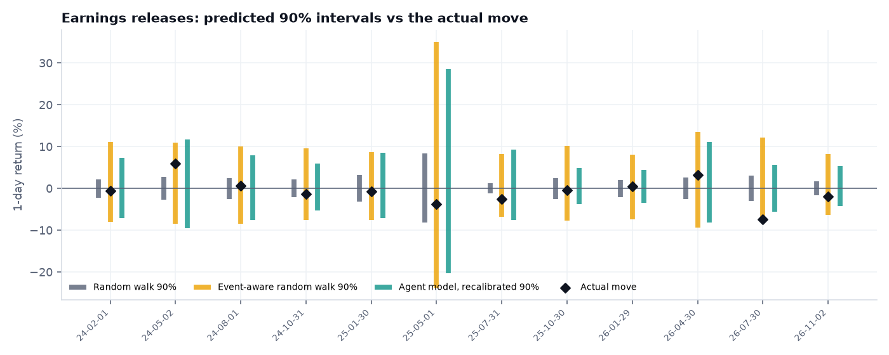
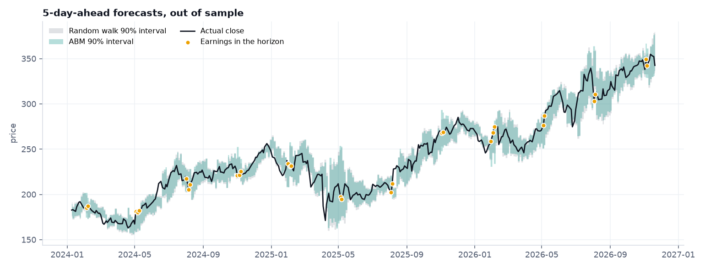

# AAPL (Apple Inc.): real events, trained then tested out of sample

Train: 2016-01-04 to 2023-12-29 · Test: 2024-01-02 to 2026-11-23 · 161 SEC filings as events (95 labelled for training, 28 in the test period). Generated by `python -m marketsim.experiment AAPL`.

## 1. Impact model (classifier + size)

Trained on 95 past events (L2 = 30.0, picked on the last 30% of the training years), tested on 28 later ones.

| | test |
|---|---|
| Class accuracy (down / flat / up) | 57% (always-majority: 57%) |
| Log loss | 0.972 (base rates: 1.039) |
| Direction hit rate on real moves | 50% of 12 |
| Size error, mean abs. log | 0.79 (constant guess: 1.00) |
| Predicted vs actual size, correlation | 0.58 |
| Earnings only: direction hit rate / size corr. | 50% of 8 / 0.51 |

**Predicted vs actual reaction, the 15 biggest test-period events** (abnormal return on the reaction day):

| reaction day | filing | actual | P(down / flat / up) | predicted size | called it? |
|---|---|---|---|---|---|
| 2026-07-31 | 8-K 2.02, 9.01 (earnings) | -8.3% | 22% / 21% / 57% | ±3.1% | no (up) |
| 2025-05-02 | 8-K 2.02, 9.01 (earnings) | -5.6% | 37% / 14% / 49% | ±9.3% | no (up) |
| 2024-05-03 | 8-K 2.02, 9.01 (earnings) | +4.8% | 27% / 23% / 49% | ±3.6% | yes (up) |
| 2026-05-01 | 8-K 2.02, 9.01 (earnings) | +3.0% | 30% / 20% / 50% | ±3.5% | yes (up) |
| 2025-02-26 | 8-K 5.07 (vote) | -2.8% | 9% / 57% / 35% | ±0.6% | no (up) |
| 2024-08-02 | 8-K 2.02, 9.01 (earnings) | +2.7% | 33% / 22% / 45% | ±3.1% | yes (up) |
| 2026-01-05 | 8-K 5.02 (executive) | -2.2% | 21% / 63% / 16% | ±0.4% | yes (down) |
| 2026-11-03 | 8-K 2.02, 9.01 (earnings) | -2.1% | 30% / 24% / 46% | ±2.5% | no (up) |
| 2026-04-21 | 8-K 5.02 (executive) | -2.0% | 17% / 63% / 21% | ±0.6% | no (up) |
| 2024-11-01 | 8-K 2.02, 9.01 (earnings) | -1.9% | 37% / 27% / 36% | ±2.6% | yes (down) |
| 2024-05-06 | 8-K 7.01, 9.01 (disclosure) | -1.8% | 26% / 50% / 24% | ±1.7% | yes (down) |
| 2024-02-02 | 8-K 2.02, 9.01 (earnings) | -1.7% | 30% / 21% / 49% | ±3.4% | no (up) |
| 2024-09-10 | 8-K 7.01 (disclosure) | -1.0% | 30% / 59% / 11% | ±0.7% | yes (down) |
| 2025-10-31 | 8-K 2.02, 9.01 (earnings) | -0.9% | 17% / 16% / 68% | ±3.6% | no (up) |
| 2026-01-30 | 8-K 2.02, 9.01 (earnings) | +0.7% | 38% / 23% / 39% | ±2.3% | yes (up) |

## 2. Simulation training

Grid over market parameters, scored by the mean one-day CRPS on training origins:

| parameters | mean CRPS (% of price) |
|---|---|
| noise_frac=0.6, mm_news_pass_through=1.0 | 1.0905 |
| noise_frac=0.6, mm_news_pass_through=0.6 | 1.0949 |
| noise_frac=0.4, mm_news_pass_through=0.6 | 1.0980 |
| noise_frac=0.8, mm_news_pass_through=1.0 | 1.1056 |
| noise_frac=0.8, mm_news_pass_through=0.6 | 1.1083 |
| noise_frac=0.4, mm_news_pass_through=1.0 | 1.1096 |
| noise_frac=1.1, mm_news_pass_through=0.6 | 1.2192 |
| noise_frac=1.1, mm_news_pass_through=1.0 | 1.2703 |
| noise_frac=1.5, mm_news_pass_through=1.0 | 1.5138 |
| noise_frac=1.5, mm_news_pass_through=0.6 | 1.5211 |

Chosen: `{'market.noise_frac': 0.6, 'market.mm_news_pass_through': 1.0}`.

**Recalibration** (fitted on the same training origins): log return ~ Normal(shrink x ensemble mean, sqrt((spread x ensemble sd)^2 + (vol weight x trailing vol)^2)).

| horizon | shrink | spread | vol weight | training CRPS, raw -> recalibrated (log-return %) |
|---|---|---|---|---|
| 1 d | 0.29 | 0.95 | 0.51 | 1.091 -> 1.065 |
| 5 d | 0.56 | 0.60 | 0.76 | 2.103 -> 2.043 |

## 3. Out-of-sample backtest, 1-day horizon (726 forecasts)

| model | CRPS (% of price) | skill vs RW | 90% coverage | direction acc. | Brier (up) |
|---|---|---|---|---|---|
| Random walk | 0.886 | +0.0% | 89% | 48% | 0.251 |
| Event-aware random walk | 0.892 | -0.7% | 90% | 48% | 0.251 |
| Agent model, raw ensemble | 0.939 | -6.0% | 85% | 50% | 0.262 |
| Agent model, recalibrated | 0.900 | -1.6% | 86% | 51% | 0.251 |
| Agent model + true event reactions (oracle) | 0.943 | -6.5% | 85% | 52% | 0.257 |

| skill vs random walk | earnings in horizon | other days |
|---|---|---|
| Event-aware random walk | -19.2% (n=12) | +0.0% (n=714) |
| Agent model, raw ensemble | -17.0% (n=12) | -5.6% (n=714) |
| Agent model, recalibrated | -4.3% (n=12) | -1.5% (n=714) |
| Agent model + true event reactions (oracle) | -22.1% (n=12) | -5.9% (n=714) |

**Biggest differences between the agent model and the random walk** (CRPS gap, % of price):

| origin → target | actual move | RW 90% | ABM 90% | ABM P(up) | RW CRPS | ABM CRPS | earnings? |
|---|---|---|---|---|---|---|---|
| 2024-05-02 → 2024-05-03 | +6.0% | -2.7% … +2.7% | -9.4% … +11.8% | 55% | 5.05 | 3.11 | yes |
| 2025-05-01 → 2025-05-02 | -3.7% | -8.1% … +8.4% | -20.2% … +28.5% | 54% | 2.13 | 4.03 | yes |
| 2026-07-30 → 2026-07-31 | -7.4% | -3.0% … +3.0% | -5.6% … +5.7% | 49% | 6.32 | 5.39 | yes |
| 2026-04-30 → 2026-05-01 | +3.2% | -2.5% … +2.6% | -8.2% … +11.1% | 56% | 2.39 | 1.73 | yes |
| 2025-04-24 → 2025-04-25 | +0.4% | -8.0% … +8.8% | -12.4% … +12.8% | 49% | 1.19 | 1.84 |  |
| 2025-01-30 → 2025-01-31 | -0.7% | -3.2% … +3.2% | -7.0% … +8.5% | 53% | 0.56 | 1.19 | yes |
| 2024-08-01 → 2024-08-02 | +0.7% | -2.5% … +2.4% | -7.5% … +8.0% | 52% | 0.49 | 1.12 | yes |
| 2024-02-01 → 2024-02-02 | -0.5% | -2.2% … +2.2% | -7.0% … +7.4% | 50% | 0.40 | 1.03 | yes |
| 2025-08-07 → 2025-08-08 | +4.2% | -2.6% … +2.6% | -2.8% … +3.4% | 56% | 3.39 | 2.89 |  |
| 2025-04-03 → 2025-04-04 | -7.3% | -4.6% … +4.8% | -4.1% … +4.5% | 54% | 5.70 | 6.06 |  |
| 2025-04-28 → 2025-04-29 | +0.5% | -8.0% … +8.5% | -5.1% … +6.5% | 57% | 1.19 | 0.82 |  |
| 2025-04-07 → 2025-04-08 | -5.0% | -5.1% … +5.2% | -4.1% … +4.6% | 52% | 3.36 | 3.72 |  |

**Every earnings release in the test period** (one day ahead, forecast made at the close before):

| release day | actual move | RW 90% | event-RW 90% | ABM 90% | ABM P(up) | oracle median | winner (CRPS) |
|---|---|---|---|---|---|---|---|
| 2024-02-02 | -0.5% | -2.2% … +2.2% | -8.1% … +11.1% | -7.0% … +7.4% | 50% | -2.1% | Random walk |
| 2024-05-03 | +6.0% | -2.7% … +2.7% | -8.4% … +11.0% | -9.4% … +11.8% | 55% | +9.8% | Event-aware random walk |
| 2024-08-02 | +0.7% | -2.5% … +2.4% | -8.4% … +10.0% | -7.5% … +8.0% | 52% | +5.6% | Random walk |
| 2024-11-01 | -1.3% | -2.0% … +2.2% | -7.5% … +9.5% | -5.3% … +6.0% | 52% | -3.4% | Random walk |
| 2025-01-31 | -0.7% | -3.2% … +3.2% | -7.6% … +8.7% | -7.0% … +8.5% | 53% | +0.4% | Random walk |
| 2025-05-02 | -3.7% | -8.1% … +8.4% | -23.7% … +35.0% | -20.2% … +28.5% | 54% | -12.6% | Random walk |
| 2025-08-01 | -2.5% | -1.2% … +1.2% | -6.8% … +8.3% | -7.5% … +9.3% | 54% | -0.4% | Event-aware random walk |
| 2025-10-31 | -0.4% | -2.5% … +2.5% | -7.6% … +10.2% | -3.7% … +4.9% | 57% | -0.8% | Random walk |
| 2026-01-30 | +0.5% | -2.0% … +2.1% | -7.3% … +8.1% | -3.4% … +4.5% | 59% | +1.0% | Random walk |
| 2026-05-01 | +3.2% | -2.5% … +2.6% | -9.3% … +13.6% | -8.2% … +11.1% | 56% | +6.2% | Event-aware random walk |
| 2026-07-31 | -7.4% | -3.0% … +3.0% | -7.1% … +12.2% | -5.6% … +5.7% | 49% | -12.8% | Agent model, recalibrated |
| 2026-11-03 | -1.9% | -1.7% … +1.7% | -6.4% … +8.3% | -4.2% … +5.3% | 58% | -3.6% | Random walk |

## 3. Out-of-sample backtest, 5-day horizon (361 forecasts)

| model | CRPS (% of price) | skill vs RW | 90% coverage | direction acc. | Brier (up) |
|---|---|---|---|---|---|
| Random walk | 2.135 | +0.0% | 85% | 50% | 0.251 |
| Event-aware random walk | 2.144 | -0.4% | 88% | 49% | 0.251 |
| Agent model, raw ensemble | 2.223 | -4.1% | 77% | 52% | 0.255 |
| Agent model, recalibrated | 2.141 | -0.3% | 83% | 52% | 0.251 |
| Agent model + true event reactions (oracle) | 2.150 | -0.7% | 74% | 51% | 0.253 |

| skill vs random walk | earnings in horizon | other days |
|---|---|---|
| Event-aware random walk | -3.9% (n=29) | +0.0% (n=332) |
| Agent model, raw ensemble | -8.0% (n=29) | -3.6% (n=332) |
| Agent model, recalibrated | -2.0% (n=29) | -0.1% (n=332) |
| Agent model + true event reactions (oracle) | +20.7% (n=29) | -3.4% (n=332) |

**Biggest differences between the agent model and the random walk** (CRPS gap, % of price):

| origin → target | actual move | RW 90% | ABM 90% | ABM P(up) | RW CRPS | ABM CRPS | earnings? |
|---|---|---|---|---|---|---|---|
| 2026-07-27 → 2026-08-03 | -9.9% | -6.4% … +6.6% | -5.0% … +8.2% | 63% | 7.62 | 9.19 | yes |
| 2024-10-25 → 2024-11-01 | -3.7% | -5.1% … +5.0% | -4.9% … +10.2% | 69% | 2.22 | 3.73 | yes |
| 2025-10-07 → 2025-10-14 | -3.4% | -5.6% … +5.8% | -3.5% … +6.7% | 68% | 1.95 | 3.28 |  |
| 2026-02-06 → 2026-02-13 | -7.9% | -5.7% … +6.0% | -3.7% … +5.7% | 62% | 5.94 | 7.20 |  |
| 2025-04-07 → 2025-04-14 | +11.6% | -11.2% … +12.4% | -9.5% … +12.8% | 57% | 8.05 | 6.88 |  |
| 2025-04-09 → 2025-04-16 | -2.3% | -16.1% … +17.9% | -12.1% … +21.9% | 63% | 2.56 | 3.65 |  |
| 2025-04-17 → 2025-04-25 | +6.2% | -17.5% … +19.5% | -13.2% … +18.4% | 56% | 4.26 | 3.21 |  |
| 2025-10-23 → 2025-10-30 | +4.6% | -5.3% … +5.5% | -5.6% … +3.8% | 37% | 2.92 | 3.95 |  |
| 2026-06-17 → 2026-06-25 | -7.0% | -5.9% … +5.8% | -4.3% … +5.9% | 59% | 5.05 | 6.03 |  |
| 2024-08-07 → 2024-08-14 | +5.8% | -6.2% … +6.3% | -5.2% … +7.8% | 61% | 3.88 | 2.96 |  |
| 2025-03-28 → 2025-04-04 | -13.5% | -6.9% … +7.0% | -5.5% … +6.8% | 55% | 11.05 | 11.96 |  |
| 2024-08-09 → 2024-08-16 | +4.7% | -6.3% … +6.7% | -4.9% … +7.9% | 63% | 2.91 | 2.01 |  |

## How to read this

- **CRPS** scores the whole forecast distribution against what happened (lower is better); **skill** = 1 − CRPS / CRPS(random walk).
- The **oracle** knows every event's true reaction, including future unscheduled ones: it is an upper bound on what event knowledge could add, not a forecast.
- Daily returns of a large stock are close to unpredictable in direction; realistic gains come from getting the *spread* right (wider before earnings, tighter on quiet days).
