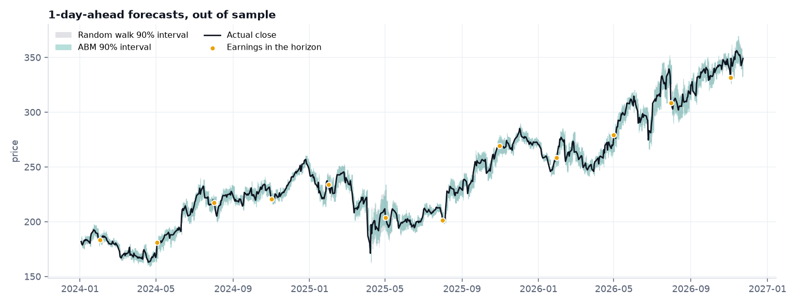
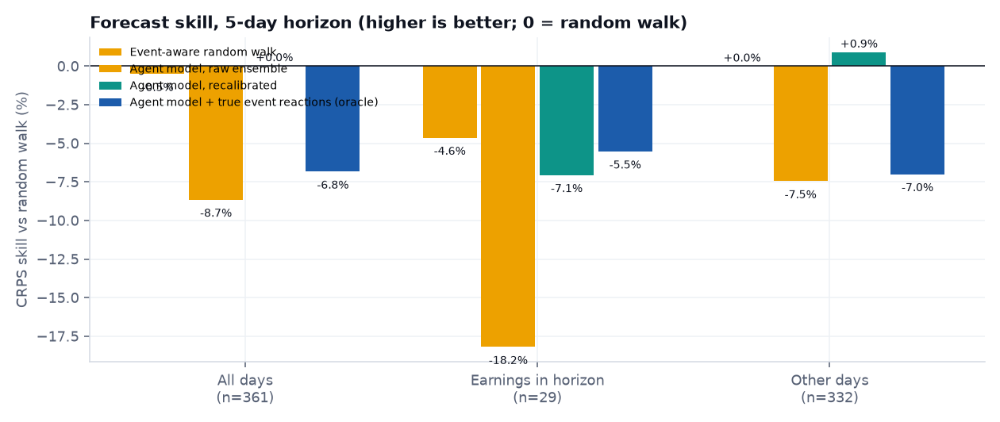

# AAPL (Apple Inc.): real events, trained then tested out of sample

Train: 2016-01-04 to 2023-12-29 · Test: 2024-01-02 to 2026-11-23 · 161 SEC filings as events (95 labelled for training, 28 in the test period). Generated by `python -m marketsim.experiment AAPL`.

## 1. Impact model (classifier + size)

Trained on 95 past events (L2 = 30.0, picked on the last 30% of the training years), tested on 28 later ones.

| | test |
|---|---|
| Class accuracy (down / flat / up) | 57% (always-majority: 57%) |
| Log loss | 0.972 (base rates: 1.039) |
| Direction hit rate on real moves | 50% of 12 |
| Size error, mean abs. log | 0.79 (constant guess: 1.00) |
| Predicted vs actual size, correlation | 0.58 |
| Earnings only: direction hit rate / size corr. | 50% of 8 / 0.51 |

**Predicted vs actual reaction, the 15 biggest test-period events** (abnormal return on the reaction day):

| reaction day | filing | actual | P(down / flat / up) | predicted size | called it? |
|---|---|---|---|---|---|
| 2026-07-31 | 8-K 2.02, 9.01 (earnings) | -8.3% | 22% / 21% / 57% | ±3.1% | no (up) |
| 2025-05-02 | 8-K 2.02, 9.01 (earnings) | -5.6% | 37% / 14% / 49% | ±9.3% | no (up) |
| 2024-05-03 | 8-K 2.02, 9.01 (earnings) | +4.8% | 27% / 23% / 49% | ±3.6% | yes (up) |
| 2026-05-01 | 8-K 2.02, 9.01 (earnings) | +3.0% | 30% / 20% / 50% | ±3.5% | yes (up) |
| 2025-02-26 | 8-K 5.07 (vote) | -2.8% | 9% / 57% / 35% | ±0.6% | no (up) |
| 2024-08-02 | 8-K 2.02, 9.01 (earnings) | +2.7% | 33% / 22% / 45% | ±3.1% | yes (up) |
| 2026-01-05 | 8-K 5.02 (executive) | -2.2% | 21% / 63% / 16% | ±0.4% | yes (down) |
| 2026-11-03 | 8-K 2.02, 9.01 (earnings) | -2.1% | 30% / 24% / 46% | ±2.5% | no (up) |
| 2026-04-21 | 8-K 5.02 (executive) | -2.0% | 17% / 63% / 21% | ±0.6% | no (up) |
| 2024-11-01 | 8-K 2.02, 9.01 (earnings) | -1.9% | 37% / 27% / 36% | ±2.6% | yes (down) |
| 2024-05-06 | 8-K 7.01, 9.01 (disclosure) | -1.8% | 26% / 50% / 24% | ±1.7% | yes (down) |
| 2024-02-02 | 8-K 2.02, 9.01 (earnings) | -1.7% | 30% / 21% / 49% | ±3.4% | no (up) |
| 2024-09-10 | 8-K 7.01 (disclosure) | -1.0% | 30% / 59% / 11% | ±0.7% | yes (down) |
| 2025-10-31 | 8-K 2.02, 9.01 (earnings) | -0.9% | 17% / 16% / 68% | ±3.6% | no (up) |
| 2026-01-30 | 8-K 2.02, 9.01 (earnings) | +0.7% | 38% / 23% / 39% | ±2.3% | yes (up) |

## 2. Simulation training

Grid over market parameters, scored by the mean one-day CRPS on training origins:

| parameters | mean CRPS (% of price) |
|---|---|
| noise_frac=0.538 | 1.1220 |
| noise_frac=0.897 | 1.1265 |
| noise_frac=1.345 | 1.2332 |

Chosen: `{'market.noise_frac': 0.538}`.

**Recalibration** (fitted on the same training origins): log return ~ Normal(shrink x ensemble mean, sqrt((spread x ensemble sd)^2 + (vol weight x trailing vol)^2)).

| horizon | shrink | spread | vol weight | training CRPS, raw -> recalibrated (log-return %) |
|---|---|---|---|---|
| 1 d | 0.51 | 1.38 | 0.60 | 1.131 -> 1.078 |
| 5 d | 1.06 | 1.49 | 0.68 | 2.238 -> 2.042 |

## 3. Out-of-sample backtest, 1-day horizon (726 forecasts)

| model | CRPS (% of price) | skill vs RW | 90% coverage | direction acc. | Brier (up) |
|---|---|---|---|---|---|
| Random walk | 0.886 | +0.0% | 88% | 48% | 0.250 |
| Event-aware random walk | 0.891 | -0.7% | 89% | 48% | 0.251 |
| Agent model, raw ensemble | 0.920 | -3.9% | 77% | 49% | 0.270 |
| Agent model, recalibrated | 0.895 | -1.1% | 90% | 48% | 0.254 |
| Agent model + true event reactions (oracle) | 0.912 | -3.0% | 76% | 51% | 0.266 |

| skill vs random walk | earnings in horizon | other days |
|---|---|---|
| Event-aware random walk | -19.3% (n=12) | +0.0% (n=714) |
| Agent model, raw ensemble | -3.6% (n=12) | -3.9% (n=714) |
| Agent model, recalibrated | +0.2% (n=12) | -1.1% (n=714) |
| Agent model + true event reactions (oracle) | +18.3% (n=12) | -3.8% (n=714) |

**Biggest differences between the agent model and the random walk** (CRPS gap, % of price):

| origin → target | actual move | RW 90% | ABM 90% | ABM P(up) | RW CRPS | ABM CRPS | earnings? |
|---|---|---|---|---|---|---|---|
| 2025-01-15 → 2025-01-16 | -4.0% | -2.2% … +2.3% | -3.7% … +3.3% | 45% | 3.28 | 2.67 |  |
| 2026-07-30 → 2026-07-31 | -7.4% | -2.9% … +3.0% | -2.2% … +3.2% | 61% | 6.31 | 6.88 | yes |
| 2024-10-04 → 2024-10-07 | -2.3% | -2.4% … +2.5% | -3.5% … +2.7% | 41% | 1.51 | 1.09 |  |
| 2026-04-30 → 2026-05-01 | +3.2% | -2.5% … +2.5% | -2.4% … +3.2% | 58% | 2.42 | 2.01 | yes |
| 2026-02-11 → 2026-02-12 | -5.0% | -2.7% … +2.7% | -3.4% … +3.1% | 45% | 4.06 | 3.66 |  |
| 2024-09-30 → 2024-10-01 | -2.9% | -2.4% … +2.4% | -3.3% … +2.8% | 45% | 2.14 | 1.75 |  |
| 2026-07-01 → 2026-07-02 | +4.8% | -3.4% … +3.5% | -4.3% … +4.7% | 52% | 3.63 | 3.24 |  |
| 2026-07-23 → 2026-07-24 | +3.5% | -4.0% … +3.9% | -3.9% … +3.2% | 42% | 2.36 | 2.74 |  |
| 2025-04-25 → 2025-04-28 | +0.4% | -7.9% … +8.4% | -5.5% … +6.2% | 51% | 1.20 | 0.84 |  |
| 2025-04-07 → 2025-04-08 | -5.0% | -5.2% … +5.1% | -4.2% … +4.3% | 52% | 3.31 | 3.66 |  |
| 2025-04-04 → 2025-04-07 | -3.7% | -5.2% … +5.4% | -5.9% … +5.1% | 46% | 2.28 | 1.95 |  |
| 2026-02-26 → 2026-02-27 | -3.2% | -3.2% … +3.4% | -4.1% … +3.8% | 47% | 2.23 | 1.90 |  |

**Every earnings release in the test period** (one day ahead, forecast made at the close before):

| release day | actual move | RW 90% | event-RW 90% | ABM 90% | ABM P(up) | oracle median | winner (CRPS) |
|---|---|---|---|---|---|---|---|
| 2024-02-02 | -0.5% | -2.3% … +2.2% | -8.5% … +10.5% | -2.1% … +2.1% | 51% | -0.2% | Random walk |
| 2024-05-03 | +6.0% | -2.6% … +2.6% | -8.3% … +10.7% | -2.6% … +3.2% | 54% | +1.1% | Event-aware random walk |
| 2024-08-02 | +0.7% | -2.5% … +2.5% | -7.9% … +10.4% | -2.7% … +3.2% | 56% | +0.7% | Agent model, recalibrated |
| 2024-11-01 | -1.3% | -2.1% … +2.1% | -7.1% … +9.6% | -2.4% … +2.5% | 50% | -0.7% | Agent model, recalibrated |
| 2025-01-31 | -0.7% | -3.1% … +3.1% | -7.7% … +8.4% | -2.9% … +2.5% | 44% | -0.8% | Agent model, recalibrated |
| 2025-05-02 | -3.7% | -7.8% … +8.3% | -24.1% … +36.1% | -9.5% … +10.5% | 52% | -2.0% | Random walk |
| 2025-08-01 | -2.5% | -1.2% … +1.2% | -7.3% … +8.2% | -1.5% … +1.3% | 47% | -0.2% | Event-aware random walk |
| 2025-10-31 | -0.4% | -2.5% … +2.6% | -7.8% … +10.2% | -2.9% … +3.3% | 55% | -0.9% | Random walk |
| 2026-01-30 | +0.5% | -2.1% … +2.1% | -6.8% … +8.0% | -2.6% … +2.0% | 40% | -0.3% | Random walk |
| 2026-05-01 | +3.2% | -2.5% … +2.5% | -9.5% … +13.8% | -2.4% … +3.2% | 58% | +0.8% | Event-aware random walk |
| 2026-07-31 | -7.4% | -2.9% … +3.0% | -7.9% … +12.5% | -2.2% … +3.2% | 61% | -1.3% | Random walk |
| 2026-11-03 | -1.9% | -1.6% … +1.7% | -6.7% … +8.5% | -2.6% … +2.4% | 47% | -0.5% | Agent model, recalibrated |

## 3. Out-of-sample backtest, 5-day horizon (361 forecasts)

| model | CRPS (% of price) | skill vs RW | 90% coverage | direction acc. | Brier (up) |
|---|---|---|---|---|---|
| Random walk | 2.136 | +0.0% | 85% | 47% | 0.251 |
| Event-aware random walk | 2.147 | -0.5% | 87% | 47% | 0.251 |
| Agent model, raw ensemble | 2.321 | -8.7% | 52% | 51% | 0.261 |
| Agent model, recalibrated | 2.136 | +0.0% | 83% | 50% | 0.253 |
| Agent model + true event reactions (oracle) | 2.282 | -6.8% | 52% | 51% | 0.255 |

| skill vs random walk | earnings in horizon | other days |
|---|---|---|
| Event-aware random walk | -4.6% (n=29) | +0.0% (n=332) |
| Agent model, raw ensemble | -18.2% (n=29) | -7.5% (n=332) |
| Agent model, recalibrated | -7.1% (n=29) | +0.9% (n=332) |
| Agent model + true event reactions (oracle) | -5.5% (n=29) | -7.0% (n=332) |

**Biggest differences between the agent model and the random walk** (CRPS gap, % of price):

| origin → target | actual move | RW 90% | ABM 90% | ABM P(up) | RW CRPS | ABM CRPS | earnings? |
|---|---|---|---|---|---|---|---|
| 2025-04-30 → 2025-05-07 | -7.6% | -17.3% … +20.0% | -15.2% … +28.1% | 63% | 4.27 | 7.39 | yes |
| 2025-04-28 → 2025-05-05 | -5.4% | -17.4% … +19.4% | -14.4% … +22.0% | 59% | 3.44 | 4.72 | yes |
| 2025-05-08 → 2025-05-15 | +7.2% | -8.5% … +8.5% | -6.2% … +9.7% | 62% | 4.76 | 3.50 |  |
| 2026-02-06 → 2026-02-13 | -7.9% | -5.5% … +5.6% | -3.8% … +6.0% | 61% | 6.04 | 7.17 |  |
| 2026-07-29 → 2026-08-05 | -8.0% | -6.3% … +6.6% | -5.9% … +9.1% | 62% | 5.94 | 6.98 | yes |
| 2025-04-17 → 2025-04-25 | +6.2% | -17.3% … +19.0% | -14.9% … +22.5% | 56% | 4.29 | 3.26 |  |
| 2025-08-13 → 2025-08-20 | -3.1% | -6.4% … +6.8% | -4.7% … +8.3% | 64% | 1.83 | 2.85 |  |
| 2026-06-26 → 2026-07-06 | +10.2% | -7.6% … +8.3% | -6.7% … +9.4% | 56% | 7.49 | 6.56 |  |
| 2025-03-28 → 2025-04-04 | -13.5% | -6.8% … +7.1% | -6.0% … +8.4% | 58% | 11.13 | 12.05 |  |
| 2025-09-15 → 2025-09-22 | +8.2% | -5.6% … +5.7% | -5.3% … +4.3% | 41% | 6.28 | 7.18 |  |
| 2025-02-20 → 2025-02-27 | -3.5% | -5.8% … +6.6% | -3.9% … +6.2% | 63% | 2.08 | 2.96 |  |
| 2025-09-03 → 2025-09-10 | -4.9% | -6.6% … +6.9% | -4.9% … +7.1% | 58% | 2.95 | 3.82 |  |

## How to read this

- **CRPS** scores the whole forecast distribution against what happened (lower is better); **skill** = 1 − CRPS / CRPS(random walk).
- The **oracle** knows every event's true reaction, including future unscheduled ones: it is an upper bound on what event knowledge could add, not a forecast.
- Daily returns of a large stock are close to unpredictable in direction; realistic gains come from getting the *spread* right (wider before earnings, tighter on quiet days).
